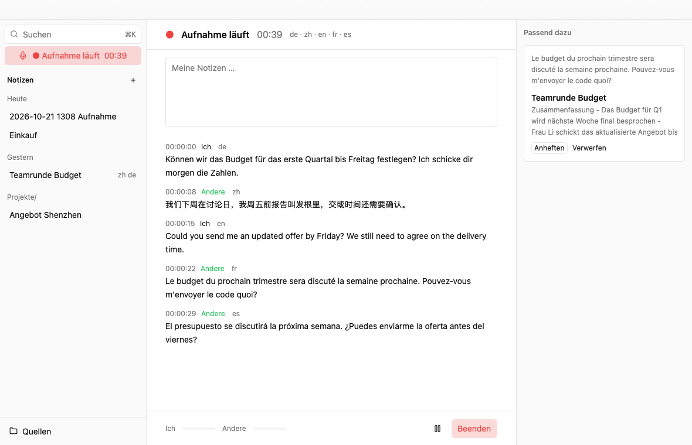

# Live Notes

Native macOS-App in Rust: Gespräche mitschneiden und **in der gesprochenen Sprache** transkribieren,
Markdown-Notizen schreiben, lokale Ordner durchsuchen und Fragen an das eigene Wissen stellen.

Transkription und Suche laufen lokal (Whisper, EmbeddingGemma, SQLite). Der Assistent nutzt ein
günstiges, multimodales Modell (Standard: Gemma 4 über OpenRouter), austauschbar über jede
OpenAI-kompatible API (OpenRouter, LiteLLM-Proxy, Ollama, lokales Gemma). Audio wird nie gespeichert.



Status: v1.0 umgesetzt, Abnahme mit echten Geräten offen – siehe [STATUS](docs/STATUS.md).
Lizenz: [Apache-2.0](LICENSE). Plattform: macOS 14.2+ auf Apple Silicon, Linux geplant.

## Schnellstart

```bash
brew install llama.cpp        # llama-server für EmbeddingGemma und lokales Gemma
cargo run --release -p ln-app
```

Beim ersten Start lädt die App ~1 GB Modelle. Ohne OpenRouter-Schlüssel funktionieren Aufnahme,
Transkription und Suche; Zusammenfassungen und Antworten brauchen einen Schlüssel oder ein lokales Modell.
Fragen, Live-Vorschläge und Zusammenfassung haben je ein eigenes Modell. Mit „Mit ChatGPT fortfahren“
in den Einstellungen läuft die Zusammenfassung über ein ChatGPT-Plus- oder Pro-Abo statt pro Token.

App-Bundle bauen: `scripts/bundle-macos.sh` → `dist/Live Notes.app`.

## Aufbau

| Crate | Aufgabe |
|---|---|
| `ln-app` | Oberfläche (GPUI / gpui-kit), Menüleiste, Tastenkürzel |
| `ln-core` | Engine: Aufnahme-Sitzungen, Indexierung, Suche, Assistent, Live-Vorschläge |
| `ln-asr` | VAD, Spracherkennung, Whisper, OpenAI-Transkription, Nachbearbeitung |
| `ln-audio`, `ln-platform` | Aufnahme (Mikrofon mit Echo-Unterdrückung, Process Tap), OCR, PDF, Schlüsselbund |
| `ln-index`, `ln-ingest` | SQLite-Index (FTS5, sqlite-vec, RRF), Dateiformate, Chunking, Dateiüberwachung |
| `ln-ai`, `ln-models` | OpenAI-kompatibler Client, Prompts, Kosten; Modellkatalog, Downloads, llama-server |
| `ln-notes`, `ln-types` | Notizformat, Journal; gemeinsame Typen und Einstellungen |
| `ln-bench` | Messungen mit echten Modellen |

## Dokumente

- [Spezifikation](docs/SPEC.md) · [Status](docs/STATUS.md)
- [Analyse von Google AI Edge Foresight](docs/foresight-analyse.md)
- [ADR-0001: UI-Framework](docs/adr/ADR-0001-ui-framework.md) · [ADR-0002: Modellanbindung](docs/adr/ADR-0002-modellanbindung.md)
